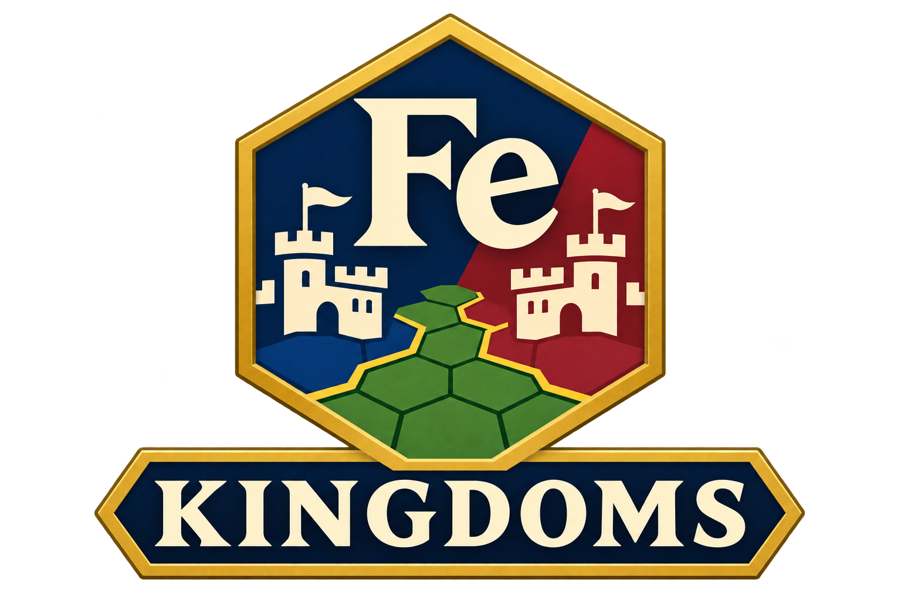

# Fe Kingdoms



A local, browser-playable kingdom-conquest game with authoritative native Fe rules and computer play. The current local preview is **rules version 8: kingdom development**. The browser and Python adapter only display and transport Fe results.

For a more playful tour, see the [behind-the-scenes companion](docs/behind-the-scenes.md).

## Current preview and replay compatibility

The reviewed v7 save/practice milestone remains unchanged on port 8769. The Windows preview uses http://localhost:8770. V8 rules and prices are preserved for replay; later physical changes require a new version. It does not replace active games on ports 8765 through 8769. Run `launch.ps1` or `scripts/preview.ps1` from this checkout to start or locate that separate preview. Both use only port 8770 and leave older servers running.

Browser saves are separate for each port. To copy a current game into the preview, use **Save replay** in the original game and **Load replay** in the preview. The original checkpoint remains untouched. New games use v8. Existing v1-v7 matches remain exact read-only replays; they are never silently converted.

## Reproduce on a fresh machine

With Docker running, prepare the toolchain image from the recorded base and the checksum-verified Fe 26.5.0 compiler (this setup downloads dependencies):

```powershell
docker build --platform linux/amd64 -f Dockerfile.toolchain -t fe-kingdoms-toolchain:26.5.0 .
.\scripts\verify.ps1 -Image fe-kingdoms-toolchain:26.5.0
.\scripts\preview.ps1 -Image fe-kingdoms-toolchain:26.5.0
```

The actual build and tests run offline. Node is required for the UI unit tests. For Linux/macOS commands, architecture limits, the generated Fe ingot and validation evidence, see [reproducibility](docs/reproducibility.md). Independent clean-machine and human-browser checks remain outstanding.

## Play and verify

From PowerShell, with Docker Desktop running and the existing pinned toolchain image available:

```powershell
# From your cloned repository directory
.\scripts\preview.ps1
```

Open the URL reported by the preview launcher. Existing instances on ports 8765 through 8769 remain unchanged.

Run all automated checks with `scripts/verify.ps1`. It uses local Node for UI unit tests and the pinned offline Fe/Python Docker image. Results and exact replays are regenerated under ignored `evidence/`; a test result must say `passed`, not `running` or `failed`.

## First turn

You are Blue. You get **two orders TOTAL across your kingdom**, not per territory. Selecting a hex is free. Owned territories are listed as expandable action cards, with only one open at a time.

Each human order is shown separately. Most actions cost one order. A moving detachment containing siege costs both orders; cavalry entering forest also costs both. Fe displays the cost before you act. After your orders run out, click **Run computer turn** to let Red act. End my turn forfeits unused orders and asks for confirmation. Fe forecasts show costs, survivors, captures and losing attacks before you commit.

On the small map, move five troops from A1 to B1, then seven from B1 to the forest village B2. Those are two one-order moves. Capture Red's capital to win while keeping your own safe.

## Campaign rules

- Three deterministic axial hex maps: 5x3, 7x5 and 9x5. Movement follows up to six shared edges. Rivers and mountains are impassable; fixed bridges provide crossings and one extra defense.
- Build an optional shared bridge at a marked river site from an adjacent supplied owned land bank for six gold, two food and one order. It is permanent and initially neutral/empty: either side can occupy it. Construction alone does not add owned territory or supply.
- Move half a stack or all but one unit. Friendly stacks combine without converting unit types, up to twelve. One garrison remains behind; Fe previews the exact infantry/cavalry/siege detachment.
- Both sides start with eight gold and twelve food, capped at forty each. Recruit two troops for three gold and two food at a supplied capital or settlement.
- Build a village for six gold; upgrade to a town for eight. Both use one order. Supplied villages/towns produce one/two gold each turn. Fortifying costs two gold, with a maximum of two levels.
- Supply follows connected owned hexes to the capital. At the incoming turn, gain base two gold plus connected settlement levels, and base three food plus two per connected farm. Each connected army pays ceil((troops minus one)/3) food; lone garrisons are free. Storage is capped before upkeep.
- Disconnected stacks lose one mobile troop and do not pay global food upkeep. Food shortages remove mobile troops from the largest armies deterministically, never eliminating lone garrisons. The display uses Fe's exact projected stock and shortage forecast for an unchanged board.
- Infantry attacks/defends at one. Cavalry adds one attack power on plain/farm targets. Siege adds two attack power against forts, settlements or capitals. All units defend at one; forts and hills/bridges add defense. A forest adds one defense if its defenders include infantry. Cavalry gets no open-ground bonus in forests. Attack power must strictly exceed defense. Fe shows exact casualties and remaining composition before each order.
- A supplied town can choose one permanent specialty for six gold, two food and one order: Granary adds two supplied food production; Arsenal reduces cavalry/siege recruitment and training gold cost by one. Capturing the town preserves its choice. Cutting supply suspends the benefit.
- Supplied towns recruit one cavalry for four gold/two food or one siege for five gold/three food. They can also train one existing infantry into that specialist at the same cost, keeping total units unchanged. This explicit paid training works at the stack cap.
- Moving detachments are proportional after reserving a garrison. Movement cost uses the actual detachment: any siege costs two orders anywhere, otherwise cavalry entering forest costs two, otherwise one. A costly move is unavailable with only one order left. Casualties remove infantry first, then cavalry, then siege. The rules remain deterministic; no random combat or hidden bonuses.
- Capture the enemy capital for immediate victory. Four consecutive pass actions draw the match. Small/medium/large campaigns pause after 60/120/180 full rounds. Choose Extend 20 rounds or Accept draw; extension begins the deferred Blue turn exactly once.
- Order forecasts show each kingdom's connected and cut-off territory before and after the order, using Fe's actual resulting state. Capture can increase connected count without reconnecting an existing holding.
- Compact opponent feedback shows Fe's actual current priority and immediate evaluation changes for its latest orders. These are not guaranteed future plans. Search reports are not stored in exported action replays.
- Easy uses one-ply greedy evaluation; Hard uses bounded four-ply beam alpha-beta search. Their rules and resources are identical, without hidden bonuses.

## Kingdom development experiment

Research is one order and is available only where Fe lists it under an owned, supplied town. Prices are initial experimental values:

- **Town Charter:** six gold. Adds one kingdom gold income per turn while at least one town is supplied. Required before either branch.
- **Crop Rotation:** six gold and two food, at a supplied Granary town. Adds one food per supplied farm, capped at two extra food per turn, while a Granary town remains supplied.
- **Organized Muster:** six gold and two food, at a supplied Arsenal town. Infantry recruiting at supplied Arsenal towns costs two gold instead of three, with the same food, troop and order costs.

Knowledge is permanent for the kingdom and does not transfer when a town is captured. Infrastructure and supply still matter: their loss suspends the benefit. A second specialized town is needed to support both branches. No combat bonus, research timer or new currency is introduced. Fe reports the exact prerequisites, canonical research town, current eligibility and resulting economy; the browser only displays those results.

The default opponent retains the A evaluator. A more complex investment estimate was tested in matched ten-round model games but did not demonstrate an improvement; it remains on local branch `experiment/v8-investment`. Neither tested Red policy researched in those samples. Expect immediate army/territory priorities rather than a fully calibrated long-term economy planner. All rules and resources remain identical for the human and computer.

## Saves and compatibility

Save replay exports the accepted action sequence, version, scenario and difficulty. Up to 2,048 actions are supported, including campaign decisions. At capacity, play pauses for export without declaring a draw; export does not itself increase this version's capacity. Fe validates every recorded action when loading. Version-1 square saves, version-2 basic-hex saves, version-3 infantry-campaign saves and version-4 mixed-army saves, version-5 continuation saves, version-6 river saves and version-7 frontier saves load through frozen engines **read-only**. They are never silently migrated. Each rules version has a separate browser checkpoint; loading an old replay does not replace the current one. Export replays to keep multiple games.

### Named campaign snapshots

Open **Named campaign snapshots**, enter a name and choose **Save current as new**. Keep up to six current-version snapshots. To pause a large game, save a named snapshot, start the shorter game, then choose the stored large snapshot and **Load selected** when ready.

Named snapshots are manual restore points: they do not change as you continue playing. **Resume campaign** still restores the one current autosave. Use **Replace selected** to update a named snapshot deliberately. Replacing or deleting asks for confirmation, and switching away from progress not held in a named snapshot warns before discarding it. Legacy replays remain read-only and exportable.

Storage failures stay visible. Export replays for durable backups and to move games between browser profiles or preview ports. This feature does not sync to a server or alter Fe rules.

### Prepared practice examples

Open **Prepared practice examples** and start either short position. **A bridge for whom?** shows that a newly built crossing belongs to nobody and may help Red. **Bring the siege, or keep an order?** compares a larger two-order detachment with a smaller capture followed by fortification.

These v8 practice positions are derived from the action prefixes of a recorded v7 model-versus-Fe game and revalidated under v8. They are not migrated player campaigns. Both choices are legal; neither is labeled optimal. The normal Fe engine handles every order and opponent response. Practice does not autosave or change campaign snapshots. Use **Reset example** to retry, or **Return to campaign** to restore the protected campaign. If current progress is not safely saved, entry is blocked until a named snapshot protects it. Portable replay export remains available.

## Current verification and balance limits

The campaign milestone has directed Fe tests for maps, routes, economy, supply, settlements, bounds and opponent determinism, plus adapter/UI/replay/full-match checks. See `docs/validation.md` and the latest generated evidence for actual results.

The v3 campaign exposed defensive stalls: fortified passes could exceed the largest infantry attack. V4 provides explicit siege recruitment/training and mixed-army attacks. Both policies pass tactical tests for training and breaching a full fortified frontier. This does not guarantee every bot match becomes decisive. Human-versus-computer is the intended use. V5 replaces automatic time draws with explicit continuation; four-pass draws remain. A fresh human playtest is needed to assess enjoyment and difficulty.

Eric playtested the original square game and the large-map visual v4 preview. He found the latter fun and challenging, but the sixty-round cap interrupted active fighting. V6 rivers, supply previews and continuation need a fresh human playtest. Mocked UI tests and HTTP tests do not establish visual browser correctness or enjoyment. The earlier visual preview has partial automated browser coverage (small-map rendering, selection and first recruitment) and Eric's later large-map human playtest. New v6/v7 visual details have mocked-UI coverage, not a new browser inspection. V7 additionally has two bounded model-versus-Fe campaigns with 96 verified Blue forecasts and exact final replays; both campaigns remained ongoing when testing stopped. The separate v7 browser inspection was blocked before a board could be inspected. See docs/validation.md for the exact boundary.

## Learn the implementation

- [Documentation index and ADRs](docs/README.md)
- [Development workflow](docs/development.md)
- [Native protocol](docs/protocol.md)
- [Guided Fe walkthrough](docs/engine-guide.md)
- `src/engine.fe`: map, state, legal orders, transitions, economy and search.
- `src/native.fe`: bounded parsing, replay and Fe-generated output/forecasts.
- `server.py` and `web/index.html`: thin transport and presentation.
- `legacy/`: frozen engines for older read-only replays.

Uses native Fe 26.5.0 (3dab95f), with compiler bytes verified by `scripts/build.py`. The pinned image and compiler hash are recorded in `toolchain.lock.json`. The local pinned-image path needs no download; fresh setup downloads the toolchain. No external game engine, LLM opponent, contract deployment or terminal UI is involved. Prior transition-lab and Dragonstales projects remain separate. The source repository is public on GitHub; the game runs locally and is not deployed as a hosted app. The game code is MIT-licensed under Eric Lizotte.

## License

The game code is provided under the [MIT License](LICENSE). The Fe Kingdoms logo, DragonsTales name and studio medallion are excluded from the code license; verify other assets and reused materials before publication.
