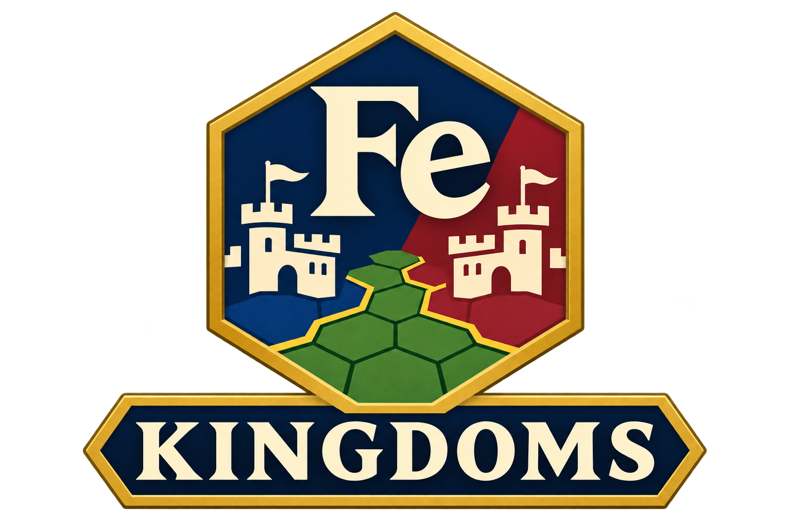
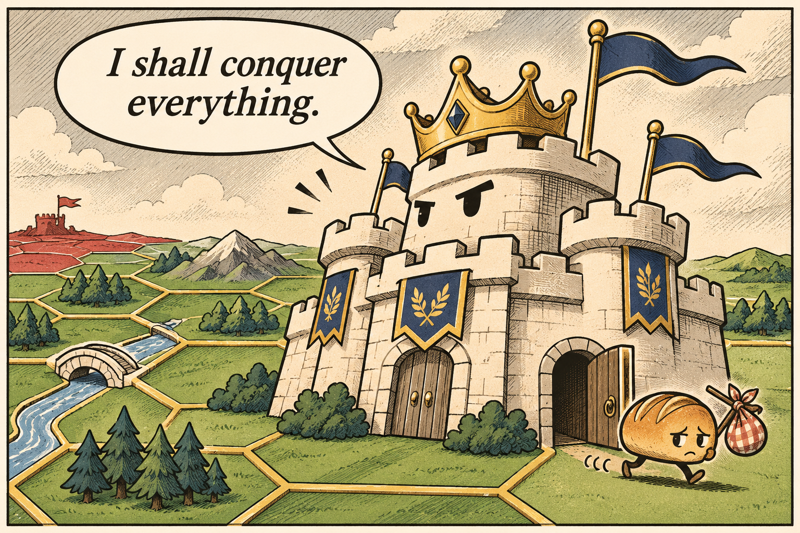
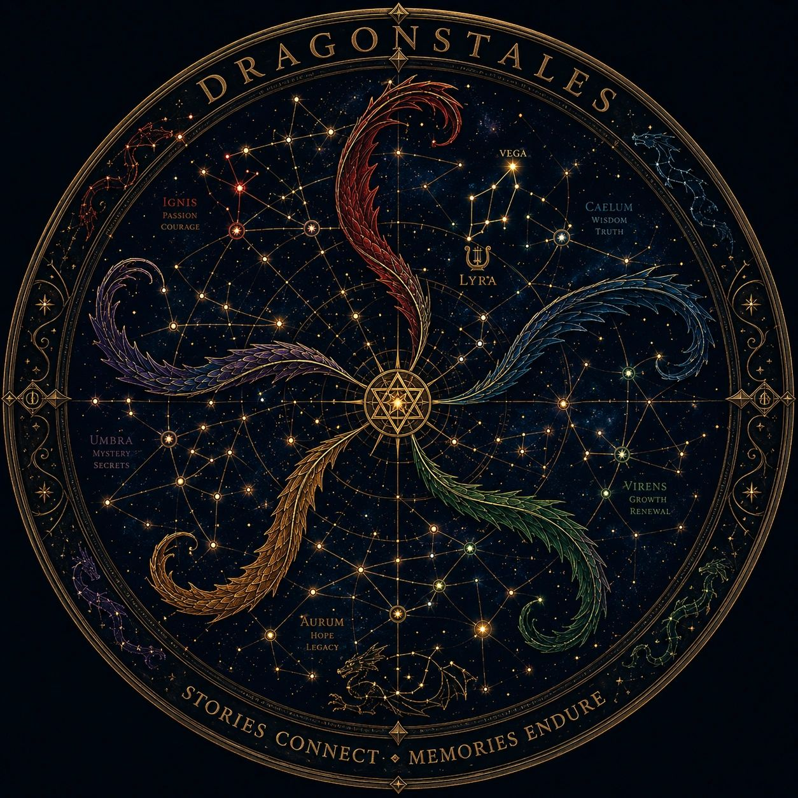

# Fe Kingdoms: a dragon-sized footnote

*A behind-the-scenes companion to a small game with a suspiciously large appetite for consequences.*

## About DragonsTales

DragonsTales is the creative home behind this experiment. Its spirit here is simple: make something worth spending an evening with, and let the documentation have a pulse. This game is a separate project; the studio medallion is a reference, not a claim that the separate Dragonstales application is part of this build. The Fe Kingdoms crest is approved; the recurring narrator remains a provisional concept, not a depiction of a real person.

## Development philosophy

The contest is an excuse to build; enjoyment is the point. Put the board in a browser, keep the decisions legible, and let a player see what an order will do before committing. Treat the computer as an opponent under the same rules, not a mysterious recipient of bonus sandwiches. Preserve old action histories when the rules evolve. And when a test stops at its budget, call it unfinished: the kingdom did not spontaneously negotiate peace because a script got tired.

## Project inspiration

The documented history describes a pivot from a differential-testing investigation to a standalone strategy game. Eric's early playtest found turn handoff confusing and Easy punishing; the interface was revised to show individual orders and explicit handoff. A later large-map v4 playtest was fun and challenging, but its round cap interrupted fighting. That led to explicit campaign continuation. The history was reconstructed after the earliest prototype; it is not a complete contemporaneous diary. [History](history.md) · [continuation decision](adr/0009-campaign-round-review.md)

## What we built

Blue and Red contest a bounded hex map with capitals, territory, settlements, supply, food, forts and mixed troops. V8 adds permanent kingdom knowledge supported by supplied towns. You can save action replays, use named local snapshots and try prepared practice positions. Older rules versions replay through frozen engines. The current baseline retains the simpler A opponent; an investment-valuation experiment exists separately and was not shown to improve play. [V8 decision](adr/0018-retain-baseline-opponent.md)

> **Storyboard panel 2 — logistics (provisional):** A loaf and coin stare at a broken road to their capital. Caption: “We appear to have been strategically inconvenienced.”

## How it works

The interesting trick is that the forecast does not maintain a second miniature rulebook. Fe enumerates legal actions in `legal`; `apply` produces the next `State`; `src/native.fe` calls that same transition for each legal action and serializes the resulting forecast. An order's displayed consequences and the actual transition therefore share an implementation. Tests compare forecasts to submitted actions; this reduces drift, though shared code alone cannot prove the rules are correct.

Supply is a breadth-first traversal through owned, passable tiles from the capital. Turn economy uses that connected map for income and attrition. For the opponent, Fe ranks legal actions using a focused evaluation of resulting positions. Easy takes the leading one-ply choice; Hard searches a bounded selection of candidates with alpha-beta pruning. A ply is an action, not necessarily a turn: the search checks which side is actually to move because a kingdom can have two orders. Beam and depth limits keep work bounded and make no promise of optimal play. Search reports are explanations of measured scores, not proof of future outcomes.

The native protocol accepts a versioned action trace, validates it and reconstructs the state. The Python server serializes requests and responses; the browser presents Fe's results and manages local saves. See [protocol](protocol.md), `src/engine.fe` (`legal`, `apply`, `supply`, `search_focused_cached`, `decide`) and `src/native.fe`. The older [engine guide](engine-guide.md) is valuable but its v6/v7 examples should not be mistaken for current v8 instructions.

> **Storyboard panel 3 — the opponent (provisional):** Red and Blue tokens contemplate branching arrows. Caption: “Four plies later, the bread remains unconvinced.”

## How to try it

Follow the short [README](../README.md) for the pinned-image prerequisites, preview, tests and a native initial-state example. Play Blue's orders, inspect the Fe forecasts, then explicitly run Red's turn. Save a replay before moving between browser origins. No server-side account or chain is needed.

## What we learned / what's next

Visible turn handoff matters. Round limits should not silently end an interesting fight. Search is expensive enough to require explicit bounds, and a plausible evaluation change is not evidence of a stronger opponent. In the documented v8 comparison, neither policy researched; the retained A baseline is a cautious choice, not a universal strength ranking. The complete v8 HTTP match also contained no research orders. An agent-driven browser check exercised a short v8 turn and replay; a fresh human v8 playtest, independent clean-machine reproduction and the submission handoff remain outstanding. [Validation](validation.md) · [A/B report](playtests/v8-ab-results.md)

> **Storyboard panel 4 — closing (provisional):** A small flag and an exhausted quill sit beside notes. Caption: “The kingdom survives. The documentation demands another turn.”

## Credits / tools / assets

Fe 26.5.0 supplies the native compiler; Docker runs the pinned toolchain; Python serves and transports; browser HTML/JavaScript presents the game. AI assistance was used in development and documentation; the responsible human should complete the precise scope and review before public release. The studio medallion and the approved Fe Kingdoms crest are included as project branding; see [visual assets](visual-assets.md) for provenance and licensing. Storyboards above are text placeholders, not commissioned or approved character designs. Confirm provenance and redistribution rights for all assets and reused material before publication.

## Stuff we had to include

The project is a prototype, not a balance proof. UI unit tests use mocked DOM and transport; HTTP and native tests are separate from a real browser and human play. See the [reproducibility notes](reproducibility.md) for source requirements, exact baseline and remaining manifest, provisioning and disclosure work. A contest video is optional. The private registration details belong nowhere in this document.
